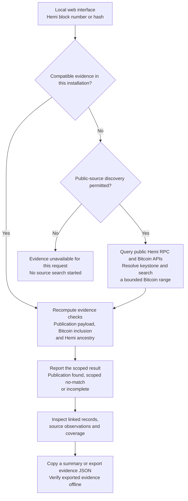

# Traze

**Trace Hemi blocks to Bitcoin publications.**

Traze is a Hemi–Bitcoin publication explorer for developers investigating the
Bitcoin publication evidence supporting a Hemi block.

Search by Hemi block number or hash, inspect the keystone connection, review
transaction inclusion and ancestry checks, and export evidence for offline
verification.

**Status:** Developer-run application with indexed search and bounded public-data
discovery. A supported hosted public service is not yet available.

## Capabilities

- Find applicable Bitcoin publications from a Hemi block number or hash.
- Inspect the requested block, covering keystone, later keystone when applicable,
  and publication transaction through a connected route.
- Review proof checks, recorded source observations and actual search coverage.
- Browse indexed publications and keystones in table or timeline views.
- Copy identifiers and evidence summaries, or download a JSON evidence export.
- Read indexed evidence through a versioned API and verify exported evidence offline.
- Inspect conditional first-publication assessments and named reference finality
  calculations when their required evidence and accepted assumptions are available.

## Run locally

Requirements: Git and Python 3.10+ with SQLite. The supplied frontend needs no
Node installation or pip dependencies. Public-source discovery requires Internet
access and available providers; this demo requires no private node or TBC/BFG access.

```shell
git clone https://github.com/itsmeaokiji/traze.git
cd traze
python -B scripts/repository.py check
python -B hemi_catalogue.py build --body-dir tests/fixtures/bitcoin_blocks
python -B hemi_lookup_web.py --mode discovery
```

Open [127.0.0.1:8765](http://127.0.0.1:8765/) and select **Find publication** after
entering a Hemi mainnet block number or full block hash. Keep the terminal running.
The [quickstart](docs/QUICKSTART.md) covers setup, included examples and troubleshooting.

## How search works

### Current workflow — developer-run application

Traze currently runs on your computer and serves its web interface locally.
The backend reuses evidence stored in that installation. In discovery mode,
it can query public Hemi and Bitcoin sources within configured resource limits.



Normal searches reuse compatible evidence before requesting new public data.
Explicit **Run new lookup** starts a bounded source search. Proof checks, source
observations and search completeness remain separate; a scoped no-match does not
establish global publication absence. Results report the checked coverage,
unresolved work and stopping reason. A match or completed assessment is not
guaranteed for every input.

For indexed retrieval without external source requests, use
`python -B hemi_lookup_web.py --mode indexed-only`. This is the command-line
default when no mode is specified. Starting the app does not start a collector.
Both local modes bind to loopback. See [search behavior and limits](docs/SEARCH_GUIDE.md)
and [serving modes](docs/SERVING.md).

## Verification scope

Traze checks publication payloads, transaction inclusion and Hemi ancestry using
the supplied evidence. Proof checks, source agreement and search completeness
remain separate. Recorded observations do not become current source checks when
a result is opened again.

Ordinary selection means **earliest observed** within the available evidence.
First-publication assessments concern a Bitcoin block height under stated rules,
recorded chain views and accepted assumptions. Reference finality calculations
are named models, not authoritative deployed Hemi finality. A no-match applies
only to checked coverage.

See [verification scope](docs/VERIFICATION.md), [first-publication assessment](docs/FIRST_PUBLICATION.md)
and [reference finality calculations](docs/FINALITY.md).

## Documentation

Start with the [documentation index](docs/README.md) for user, integration,
verification and operator guides. [Terminology](docs/GLOSSARY.md) explains the
record and status names used throughout Traze.

The backend uses Python and SQLite; the frontend uses React, TypeScript and Vite.
See [development](docs/DEVELOPMENT.md), [contributing](CONTRIBUTING.md),
[the roadmap](docs/ROADMAP.md) and [change notes](CHANGELOG.md).
Automated results are available in [Repository checks](https://github.com/itsmeaokiji/traze/actions/workflows/checks.yml).

## License

Original Traze code is licensed under the [MIT License](LICENSE),
Copyright (c) 2026 itsmeaokiji. Third-party code and assets retain their terms.
See [licensing and attribution](docs/LICENSING.md) and [third-party notices](THIRD_PARTY_NOTICES.md).
