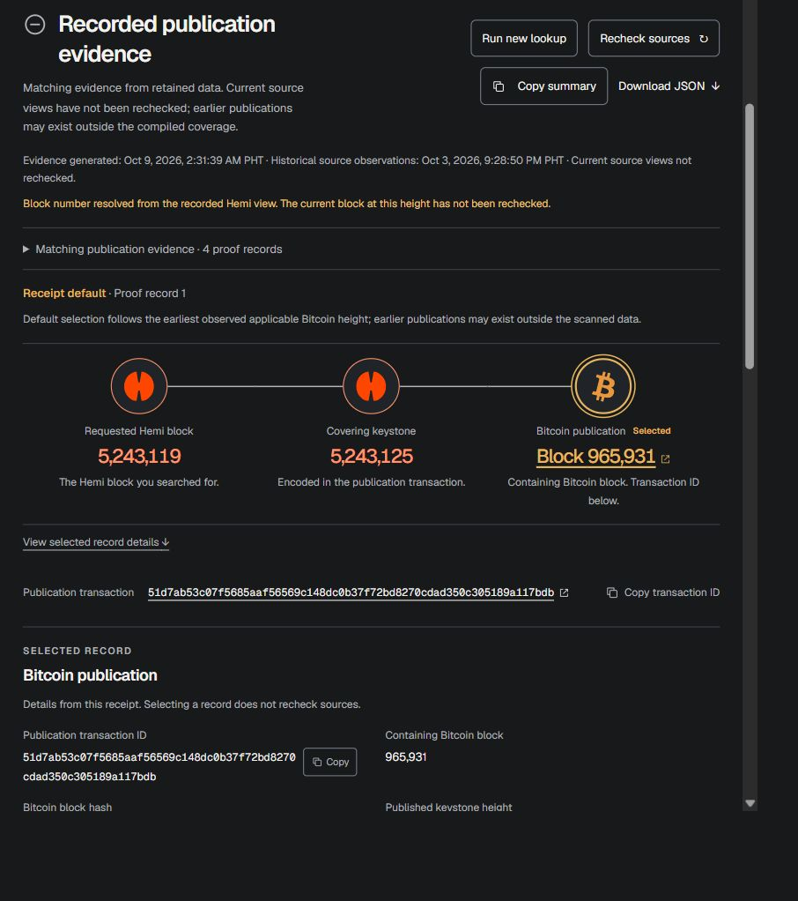

# Traze

**Trace Hemi blocks to Bitcoin publications.**

Inspect keystone connections and Bitcoin transactions, with clear sources and checkable evidence.

Traze is a Hemi–Bitcoin publication explorer that connects Hemi blocks and keystones to applicable Bitcoin publication transactions, with inspectable evidence, recorded source observations, and clear search coverage.

**Status:** Local developer explorer with bounded public-data discovery, a publication timeline, reusable indexed evidence, named reference finality models and opt-in collection. Sustained service operation and supported public hosting remain open validation work.

A separate [hosting preparation candidate](docs/HOSTING.md) supplies a bounded
production WSGI read adapter, proxy/process templates, operational checks and
verified backup/restore tools. It has not been released as a hosted public beta.



*Recorded example: Hemi 5,243,119 → covering keystone 5,243,125 → Bitcoin 965,931. This screenshot shows historical evidence and its qualifications, not a new chain check.*

## What you can do

- Start with a supported Hemi mainnet block number or hash.
- Retrieve usable indexed historical evidence; explicitly enable developer discovery mode for bounded public-data searches.
- Inspect direct/later keystone relationships, Bitcoin transactions and containing blocks.
- See proof checks, recorded source observations, coverage and missing work separately.
- Select matching proof records and copy identifiers or a plain-text evidence summary.
- Browse paginated publication/keystone summaries and open exact-identity record links.
- Explore an [indexed publication timeline](docs/TIMELINE.md), highlight an exact
  keystone's displayed publications and inspect their containing Bitcoin blocks.
- Integrate indexed records through a documented, source-free [read API](docs/READ_API.md).
- Export JSON evidence and recompute its checks offline.
- Inspect a separate conditional first-publication assessment when its full
  evidence is available, and optionally export the matching verification package.
- Inspect named [reference finality calculations](docs/FINALITY.md) from checked
  publication evidence and recorded Bitcoin tips, with separate model meanings,
  historical timestamps, unavailable states and an optional calculation export.

Operators can also backfill declared historical ranges, inspect unresolved
associations and run an explicitly configured ongoing collector. These are
separate from ordinary visitor searches; starting the website does not start
collection or make missing metadata available automatically.

The intended first workflow is developer investigation: start with a Hemi block from logs or an explorer, identify an applicable supporting Bitcoin transaction, explain the relationship and share checkable evidence.

## Run the developer demo

With Git and Python 3.10+:

```shell
git clone https://github.com/itsmeaokiji/traze.git
cd traze
python -B scripts/repository.py check
python -B hemi_catalogue.py build --body-dir tests/fixtures/bitcoin_blocks
python -B hemi_lookup_web.py --mode discovery
```

Open [127.0.0.1:8765](http://127.0.0.1:8765/), enter a Hemi mainnet block number or full block hash and select **Find publication**. You can choose your own input; supplied examples are optional. Discovery mode reuses compatible evidence and can contact public providers to find or extend missing evidence. It requires Internet access for that work. Finding a publication or completing the stronger assessment is not guaranteed for every input.

The supplied build needs no Node installation or pip dependencies. The catalogue build above uses selected public historical fixtures without live chain calls. Those fixtures are reproducible samples; private caches, session ledgers and generated lookup state are excluded from Git. Keep the terminal running while using the app; stop it with Ctrl+C after the active lookup finishes.

Follow [the quickstart](docs/QUICKSTART.md) for the live-search limits, optional
offline examples, evidence exports and setup troubleshooting. Ordinary publication
proofs and the separate conditional first-height assessment have different
requirements; missing stronger evidence does not erase a valid ordinary proof.

For source-free recorded retrieval, run `python -B hemi_lookup_web.py --mode indexed-only`
instead. This is also the command-line default when no mode is specified. It
never starts a source scan for an unavailable input. Indexed searches create no
permanent per-query result files, and JSON download is optional. Discovery-mode
results and acquired evidence are saved by the local server for reuse. See
[serving modes](docs/SERVING.md) for details. Both modes remain loopback-only;
this is not a hosted public beta.

## Verify evidence offline

```shell
python -B hemi_lookup_cli.py verify demo_results/mainnet_5243117.json --json
```

Positive checks operate on supplied data. A zero-proof negative packet does not contain a cryptographic absence proof.

Read [verification scope](docs/VERIFICATION.md) and [example provenance](demo_results/README.md).

An optional [recorded snapshot example](examples/snapshot-first-height/README.md)
lets developers check the version-3 assessment offline without a running website.
Its approximately 15 MB packet contains public evidence and recorded context;
policy and context acceptance remain explicit caller choices. It is not imported
into the app automatically and does not replace searching your own block.

## Stack and data

Python standard-library discovery/verification, SQLite catalogue and immutable JSON receipts form the backend. React + TypeScript + Vite and custom SVG/CSS form the frontend.

The optional production adapter uses checksum-pinned Waitress; ordinary local
serving and offline verification require no pip dependencies.

The demonstrated live path uses basic public Hemi RPC and configured public Bitcoin APIs. It requires no private node, TBC/BFG access, API key or paid service for this demo. External-source availability and sustainable production access remain operating questions.

The fixture corpus contains 17 historical Bitcoin bodies totaling 25,845,550 bytes across two disjoint periods. The supplied fixture catalogue compiles 22 supported publication occurrences, with 10 associated and 12 unassociated records. This is declared sample coverage, not complete Hemi/Bitcoin history.

An optional finite collector can acquire additional Bitcoin blocks ahead of user searches, check Hemi associations and update a managed evidence index. It retains job progress and resource accounting on resume. Indexed searches remain available during collection. Starting the website does not start collection; see [collection and recovery](docs/COLLECTION.md).

For explicit historical intervals, [finite backfill and coverage accounting](docs/HISTORICAL_BACKFILL.md) can seed a separate working index, repair retained associations and report each required height under one original shared allowance.

An index can retain its original lifetime ledger in a separate operator state
directory. [Paired backup and recovery](docs/PAIRED_RECOVERY.md) preserves that
binding, required reports and stop controls, restores to a new location and keeps
acquisition blocked until later authoritative state is reconciled. Private state
and local pilot results are not included in this source distribution.

An opt-in ongoing controller can continue bounded jobs from a saved cursor under an explicit renewable operating policy. Period quotas span jobs and restarts; compiled evidence survives disposable-cache eviction. It requires a reviewed policy and an explicit run command. See [ongoing collection and operating limits](docs/OPERATING.md).

## Evidence boundaries

Use **earliest observed** for ordinary publication selection. When the separate
history/interval checker passes and the server operator accepts its explicit
assumptions, the website can show **First applicable publication under supported
rules**. This is a conditional first Bitcoin block-height assessment in a
recorded chain view, not an unconditional independent global proof. See
[first-publication assessment](docs/FIRST_PUBLICATION.md) for search behaviour,
operator policy, failure states and optional portable verification.

With matching prepared snapshot context, a separate version-3 policy can show
**First applicable publication under snapshot assumptions**. It binds a specific
Hemi snapshot and keeps validating-source and historical-profile premises
explicitly external. Both policy and exact context acceptance are required;
automatic snapshot-context collection for arbitrary searches is not implemented.
See [snapshot assurance](docs/SNAPSHOT_ASSURANCE.md).

A scoped no-match applies to checked coverage. Missing data or an unavailable
source is not global publication absence.

Traze does not independently execute Hemi, validate full Bitcoin consensus/chainwork/UTXO state, calculate authoritative Hemi finality counters or verify PoP reward eligibility. Raw Bitcoin depth and provided-data proof validity have narrower meanings.

The reference calculator recomputes pinned BFG arithmetic and a separately named
AMA model. A conditional recorded Hemi-block calculation needs matching stronger
evidence and separately accepted operator contexts. These model results are not
verified equivalents of a deployed Hemi endpoint or current-chain finality.

Runtime cache, session accounting and generated receipts stay local in `.hemi_lookup_data/`. Preserve existing accounting and evidence when resuming. Live lookup/recheck remains bounded; see [the quickstart](docs/QUICKSTART.md#local-state-and-live-requests).

## Development

```shell
python -B -m unittest discover -s tests -v
node --test catalogue_demo/demo.test.mjs
```

For frontend development, from `frontend/`:

```shell
npm ci --ignore-scripts --no-audit --no-fund
npm test
npm run typecheck
npm run build
```

Follow [development instructions](docs/DEVELOPMENT.md) and [contribution guidance](CONTRIBUTING.md). Tests use included evidence and controlled sources; dependency installation may access npm.

## Roadmap

The local evidence workflow, selected timeline/reference-model expansions,
historical backfill and collection/recovery controls are implemented. Short local
operating samples support continued validation; sustained source capacity,
actual-host recovery and independent-user public-service readiness remain open.

See [the roadmap](docs/ROADMAP.md), [repository contents](docs/REPOSITORY.md) and [change notes](CHANGELOG.md). Current automated results are available in [Repository checks](https://github.com/itsmeaokiji/traze/actions/workflows/checks.yml).

## License and notices

Original Traze code is licensed under the [MIT License](LICENSE), Copyright (c) 2026 Neru. Third-party code and assets retain their applicable terms; the project license does not grant trademark rights. See [licensing](docs/LICENSE_REVIEW.md), [third-party notices](THIRD_PARTY_NOTICES.md) and [frontend notices](frontend/THIRD_PARTY_NOTICES.md).
